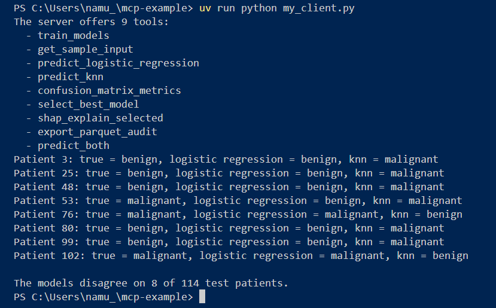
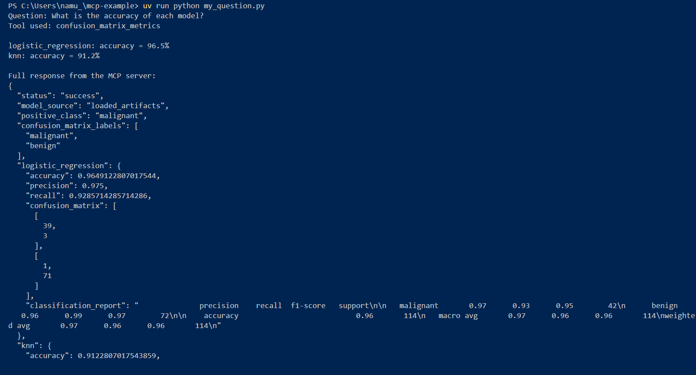

## Question 1
**How many tools did the server list in Part 1, and how many in Part 3? What did you have to change in the client to make the new tool appear?**
There server listed 8 tools in part 1 and 9 tools in part 3. The new tool was `predict_both`. I did not need to change anything in the clinet to make the new tool appear. It asked the server for a list of its tools when it connected and `predict_both` showed uo on its own.

## Question 2
**On how many of the 114 test patients do the two models disagree? For each of those patients, which model was right?**
The models disagreed on 8 of the 114 test patients. 

The models that were right for those patients were:
- Patient 3 was benign and logistic regression got it right.
- Patient 25 was benign and logistic regression got it right.
- Patient 48 was benign and logistic regression got it right.
- Patient 53 was malignant and KNN got it right.
- Patient 76 was malignant and logistic regression got it right.
- Patient 80 was benign and logistic regression got it right.
- Patient 99 was benign and logistic regression got it right.
- Patient 102 was malignant and logistic regression got it right.



## Question 3
**Overall, which model was right more often when they disagreed?**
Logistic regression was right more often. Of the 8 disagreements, it got 7 correct. KNN on the other hand was only correct on 1.

## Question 4
**In your own words: why does the description in triple quotes (`"""..."""`) matter when an AI app uses this tool?**
It matters because the AI decides which tool to use based on what the tool says it does, not on what the code actually does. The description is the AI's only explanation of the tool's purpose, so a tool is only as useful as how clear its description is. For example, if a user asks "do the two models agree on this patient?", the AI only knows to use `predict_both` because its description says it runs both models and checks if they agree. Without a clear description, the AI wouldn't know this tool is the right one, so it might skip it or use it the wrong way.


## Question 5
**Why is it useful for the server to log every tool call?**
Logging matters because an AI calls tools on its own, so without a record nobody would know what it actually did. The log lets you trace any result back to the exact call that produced it. That helps with fixing errors, since you can see which call failed and why. It also matters for accountability, especially here, where the tools make medical predictions: if a diagnosis is ever questioned, the log shows exactly which tool and model produced it.

## My Own Question
**Question:** What is the accuracy of each model?

I asked this through a client script (`my_question.py`) in VS Code, which called the server's `confusion_matrix_metrics` tool.

**Answer from the MCP server:**

```
logistic_regression: accuracy = 96.5%
knn: accuracy = 91.2%
```

Snippet of the full response:

```json
"logistic_regression": {
  "accuracy": 0.9649122807017544,
  "precision": 0.975,
  "recall": 0.9285714285714286
},
"knn": {
  "accuracy": 0.9122807017543859,
  ...
}
```

Logistic regression is more accurate, correctly classifying 96.5% of the 114 test patients compared to 91.2% for KNN.

